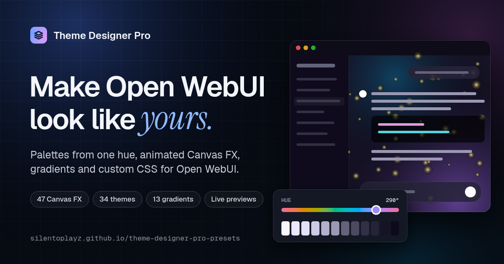

# Theme Designer Pro

[](https://github.com/silentoplayz/theme-designer-pro-presets/actions/workflows/build-bundles.yml)


Theme Designer Pro themes your whole [Open WebUI](https://github.com/open-webui/open-webui): a palette built from one hue, animated Canvas FX backgrounds, gradients and custom CSS. Admins set the theme every user sees, and each user can have a theme of their own. This repository holds Theme Designer Pro itself and its community presets.

**[Website](https://silentoplayz.github.io/theme-designer-pro-presets/)** · **[Studio](https://silentoplayz.github.io/theme-designer-pro-presets/studio/)** · **[Preset gallery](https://silentoplayz.github.io/theme-designer-pro-presets/gallery/)** · **[Documentation](event-function/README.md)** · **[Discussions](https://github.com/silentoplayz/theme-designer-pro-presets/discussions)**

[](https://silentoplayz.github.io/theme-designer-pro-presets/)

---

## ✨ Start here

| I want to… | Go to |
|---|---|
| Theme my Open WebUI | [Install the event function](#-install) |
| Design a theme without installing anything yet | The [Studio](https://silentoplayz.github.io/theme-designer-pro-presets/studio/), which designs in your browser, tunes an animation's own settings, and downloads a theme file the designer imports |
| Find a ready-made look | The [preset gallery](https://silentoplayz.github.io/theme-designer-pro-presets/gallery/), with a live preview of every theme, animation, gradient and CSS preset |
| Change my theme from a chat | The [Launcher Tool](launcher/README.md) |
| Share a preset I made | **Submit to the gallery** in the Studio, the [theme submission form](https://github.com/silentoplayz/theme-designer-pro-presets/issues/new?template=theme-submission.yml), or [Contributing](CONTRIBUTING.md) |
| Ask a question or suggest an idea | [Discussions](https://github.com/silentoplayz/theme-designer-pro-presets/discussions): [Q&A](https://github.com/silentoplayz/theme-designer-pro-presets/discussions/categories/q-a), [Show and tell](https://github.com/silentoplayz/theme-designer-pro-presets/discussions/6) or [Ideas](https://github.com/silentoplayz/theme-designer-pro-presets/discussions/7). Bugs go to [Issues](https://github.com/silentoplayz/theme-designer-pro-presets/issues). |

---

## 🚀 Install

Theme Designer Pro is an event function for **Open WebUI v0.11.0 or later**.

1. **Add the event function.** Get it from [its community page](https://openwebui.com/posts/b44c56ec-1fbd-4b42-9787-2a4facd5f047), or paste [`event-function/theme_designer_pro_event.py`](event-function/theme_designer_pro_event.py) into **Admin Panel > Functions > Create New Function**.
2. **Turn it on** in the Functions list.
3. **Open the designer.** In **Settings**, choose **Themes** in the Admin section, or go to `/api/v1/theme-designer` for the full-screen designer.

To give every user a theme of their own, turn on the event function's **Allow Personal Themes** valve. Each user then gets a **Themes** tab in their own Settings.

> [!WARNING]
> **Behind nginx or another reverse proxy?** Add `proxy_buffering off;` to its location block. Without it, other pages see a theme change only after a reload.

The [event function's README](event-function/README.md) covers every feature, valve and setting.

---

## 📥 Importing presets

The quickest way: choose **Install on my Open WebUI** on any preset in the [gallery](https://silentoplayz.github.io/theme-designer-pro-presets/gallery/) or any theme in the [Studio](https://silentoplayz.github.io/theme-designer-pro-presets/studio/). The first time, tell the site your Open WebUI address. It then opens your designer with the import ready, and you confirm it there. This needs Theme Designer Pro v1.11.0 or later.

By hand: every preset in the gallery has an import link. In Theme Designer Pro, open any **Import** dialog, paste the link and choose **Load URL**. A regular GitHub page link works too: the designer turns it into the raw file link.

You can also drop any `.js`, `.css` or `.json` file from this repository anywhere on the designer, and it goes to the right gallery.

### Everything at once

Paste this link into an Import dialog to get every animation, CSS preset, theme and gradient in one go:

```
https://raw.githubusercontent.com/silentoplayz/theme-designer-pro-presets/main/bundles/everything.json
```

### One kind at a time

| Bundle in [`bundles/`](bundles/) | Contains |
|---|---|
| **`everything.json`** | **Every preset** |
| `canvas-fx-all.json` | All Canvas FX scripts |
| `css-presets-all.json` | All CSS presets |
| `themes-all.json` | All themes |
| `gradients-all.json` | All gradients |
| `gradients-still.json` | Gradients that don't move |
| `gradients-animated.json` | Gradients that drift |

### One preset at a time

- **Canvas FX:** Canvas FX tab > Import, with a `.js` file from [`canvas-fx/`](canvas-fx/)
- **CSS:** Style Overrides tab > Import, with a `.css` file from [`css-presets/`](css-presets/)
- **Themes:** Theme Library > Import, with a `.json` file from [`themes/`](themes/)
- **Gradients:** Gradient tab > Import, with a `.json` file from [`gradients/`](gradients/)

---

## 📁 What's in this repository

### The plugins

| Folder | What it is |
|---|---|
| [`event-function/`](event-function/) | **Theme Designer Pro**, the event function. The maintained version: the instance theme, personal themes, the designer in Settings, and live updates to every open page. Themes are served through Open WebUI's shared `/static/loader.js` and `/static/custom.css`, so it works alongside other plugins and never writes to the frontend build. |
| [`launcher/`](launcher/) | **Theme Designer Pro Launcher**, a companion Tool. It turns a description such as _"make my chat a koi pond"_ into a whole theme, with an animated background from this repository's catalog, and shows it in the chat as a card with a live preview and **Apply**. It also opens the designer inside a chat when asked. It needs the event function, and **iframe Sandbox Allow Same Origin** turned on in each user's **Settings > Interface**. |
| [`tools/`](tools/) | **Theme Designer Pro Tool**, the original chat-based version, which kept themes in one browser. **Legacy:** it gets no more updates, and the event function covers what it did. |

### The presets

| Folder | What's in it |
|---|---|
| [`themes/`](themes/) | Complete themes as `.json`: a palette and settings for each mode (Dark, OLED, Light and Her), with any Canvas FX, gradient and custom CSS they use. Each has an `updateUrl`, so the designer can check it for updates. |
| [`canvas-fx/`](canvas-fx/) | Animations as standalone `.js` files. They run behind the interface in a Web Worker on an OffscreenCanvas, and many have a `CONFIG` block of settings you can tune with sliders, in the designer and in the Studio. Those tagged **Follows your theme** draw in the theme's colors (Theme Designer Pro v1.12.0 or later). |
| [`gradients/`](gradients/) | Gradient presets, sorted by motion (`still/`, `animated/`) and then by type (`linear/`, `radial/`, `mesh/`). |
| [`css-presets/`](css-presets/) | Styling as plain `.css` files: fonts, colors, spacing, components and effects. |
| [`bundles/`](bundles/) | The presets combined into single files for one import each. Built by CI; see [`bundles/README.md`](bundles/README.md). |

### Everything else

| Path | What it is |
|---|---|
| [`docs/`](docs/) | The [website](https://silentoplayz.github.io/theme-designer-pro-presets/): the home page, the Studio and the preset gallery. [`docs/README.md`](docs/README.md) says how to run it locally. |
| [`manifest.json`](manifest.json) | Every theme with its current version and update link, so the designer can check all themes for updates in one request. Built by CI. |
| [`schemas/`](schemas/) | JSON schemas for themes, Canvas FX, CSS presets, gradients and the manifest. |
| [`scripts/`](scripts/) | Validation and the build scripts CI runs. |
| [`.github/`](.github/) | Issue forms (bug report, preset and theme submissions), the pull request template, and the workflows below. |

---

## ⚙️ How the repository runs itself

Three [GitHub Actions workflows](.github/workflows/) validate presets, build the generated files, process submissions and publish the website.

### Validate & Build Bundles ([`build-bundles.yml`](.github/workflows/build-bundles.yml))

Runs on pushes to `main` that change a preset or a script: `.js` in `canvas-fx/`, `.css` in `css-presets/`, `.json` in `themes/`, `gradients/` or `schemas/`, or `.js` in `scripts/`. Edits to documentation don't start it.

1. **Validate.** [`scripts/validate.js`](scripts/validate.js) checks every preset:
   - **Canvas FX:** the [house standard](canvas-fx/README.md): `init` and `resize` cases, no DOM access, no heartbeat, WebGL context loss handled, with warnings for no theme support or more than 20 KB
   - **CSS** (presets and every theme's custom CSS): no rule on `#chat-input-container`, the square box inside the rounded input, with warnings for selectors that match nothing in current Open WebUI and for blanket `input`, `textarea` or `*` rules
   - **Themes:** a `name`, an `updateUrl`, at least one mode, and valid OKLCH color fields
   - **Gradients:** the type, the stops, and the right subfolder
   - **Bundles:** flags that match what each bundle contains
2. **Build** the bundles, `manifest.json`, the preset counts in this README's badges, and `docs/catalog.json`, the list the website draws from.
3. **Commit** the generated files when anything changed.

On pull requests, only the validation step runs, so contributors see right away whether their presets are formatted correctly.

### Theme Submission Bot ([`theme-submission.yml`](.github/workflows/theme-submission.yml))

Runs when someone opens a [theme submission](https://github.com/silentoplayz/theme-designer-pro-presets/issues/new?template=theme-submission.yml) issue. It takes the theme JSON from the issue, checks the required fields, the OKLCH values and any Canvas FX script, and then either opens a pull request with the theme or comments with what to fix. Anyone can submit a theme this way without using git; see [CONTRIBUTING.md](CONTRIBUTING.md).

### Deploy to GitHub Pages ([`deploy-pages.yml`](.github/workflows/deploy-pages.yml))

Publishes [`docs/`](docs/) as the [website](https://silentoplayz.github.io/theme-designer-pro-presets/). It runs after a successful build, so the site always has the latest catalog, and on any push that changes `docs/`, `event-function/`, `launcher/` or `tools/`. Only one deployment runs at a time, and a newer one cancels an older one.

### Checking presets locally

```bash
node scripts/validate.js
```

> [!NOTE]
> Don't commit files you built locally. CI builds the bundles, manifest, badges and catalog on push, and a local copy causes merge conflicts on the next build. Run the build scripts to test if you need to, then discard what they changed before you commit.

---

## 🤝 Contributing

See [CONTRIBUTING.md](CONTRIBUTING.md) for how to submit presets, the quality bar, and how presets are reviewed. Everyone taking part is expected to follow the [Code of Conduct](CODE_OF_CONDUCT.md).

## 📜 License

[MIT](LICENSE). Free to use, change and share.
