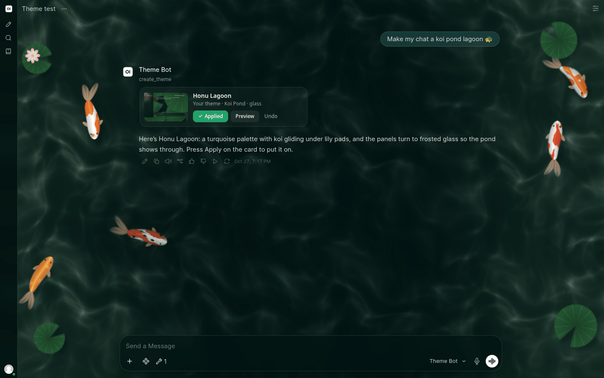
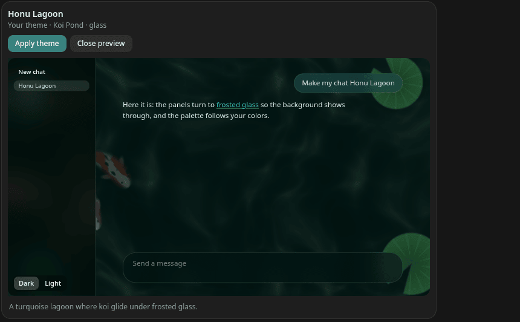

# 🚀 Theme Designer Pro Launcher

The Launcher is a companion Tool for the [Theme Designer Pro event function](../event-function/). It lets you theme Open WebUI from a chat. Describe the theme you want, such as _"make my chat a koi pond"_, and the chat model builds a whole theme: a palette and accent in your colors, an animated background, and frosted glass panels so the background shows through. The chat shows it as a card with a live preview. Press **Apply** and your chat changes in place.

Everyone gets their own personal theme this way, and admins can also change the instance theme that every user sees.

The Launcher is on the Open WebUI community platform as [Theme Designer Pro Launcher](https://openwebui.com/posts/467b9ac8-731b-4d60-bafe-9fb4e2dfda35).

---

## 💬 What you can ask

| Ask | What happens |
|---|---|
| _"Make my chat a koi pond"_ | A card shows the new theme with a live preview: a turquoise palette, the **Koi Pond** animation and glass panels. **Apply** puts it on your personal theme and adds it to your Theme Gallery. **Undo** puts back the theme you had. |
| _"Give me a warm copper theme"_ | A still theme: the palette and a matching gradient. |
| _"Something cozy with falling leaves, for everyone"_ | For an admin, the card applies to the instance theme every user sees. A user who asks for _"everyone"_ still only changes their own theme. |
| _"A dark purple theme, just for OLED mode"_ | The card applies to one mode (Dark, OLED, Light or Her) and leaves the others alone. |
| _"Open Theme Designer Pro"_ | The designer opens inside the chat, for working on a theme by hand. This is the only time the Launcher shows the designer in a chat. |

**Preview** opens a larger live preview in the card, a small Open WebUI page in the theme, with a Dark and Light switch. Nothing changes until you press **Apply**.

### Where the animations come from

The animated backgrounds are the Canvas FX scripts in this repository's [catalog](../canvas-fx/): koi ponds, deep oceans, aurora, rain and lightning, falling leaves, snow, fireflies, embers, starry constellations, a synthwave sun, matrix rain and more. The chat model only describes the background it wants. The Launcher, on your server, picks the closest animation from the catalog by its name and description and puts that script in the theme. A chat model never writes code that runs on your page. When nothing in the catalog fits, the theme has no animation, and the chat model is told what the catalog has.

---

## ✅ Before you start

- **Open WebUI v0.11.0 or later**, with the **Theme Designer Pro event function v1.17.0 or later** installed and turned on.
- **For users:** the event function's **Allow Personal Themes** valve turned on. Without it, the card says personal themes are turned off. Admins can still change the instance theme.
- **For everyone who uses it:** **Settings > Interface > iframe Sandbox Allow Same Origin** turned on, in their own settings. Open WebUI shows a Tool's output in a sandboxed frame. Without this setting, that frame has no origin of its own, so it can't sign in to the designer: the card still previews the theme, but **Apply** stays off and the card names the setting. With it on, HTML that tools and models show in your chats runs with your Open WebUI page's access, so turn it on only on an instance whose tools you trust.
- **Animated backgrounds:** the server reaches `raw.githubusercontent.com` once an hour at most to read the catalog. Without internet access, themes are palette, gradient and glass only. The **Canvas Catalog Url** valve points it at your own copy.
- **A model that calls tools.** It works with both **Default** and **Native** function calling.

---

## 📦 Install

1. Go to **Workspace** > **Tools** > **Create New Tool**.
2. Copy the contents of [`theme_designer_pro_launcher.py`](theme_designer_pro_launcher.py), or the code on the Launcher's [community page](https://openwebui.com/posts/467b9ac8-731b-4d60-bafe-9fb4e2dfda35), paste it in, and save.
3. **Share it with your users.** A Tool an admin creates is private until you give users or groups access to it in the Tool's access settings.
4. Turn it on for a chat from the tools button in the message box. To have it on by default, add it to a model under **Workspace** > **Models** > the model > **Tools**.

The Launcher's **Designer Url** valve must match the event function's **Designer Url** valve. Both default to `/api/v1/theme-designer`.

---

## 🔒 Why a chat can't change your theme on its own

A theme from a chat changes nothing until you press **Apply** on its card. **Apply** opens the designer out of sight with a link the Launcher signed, hands it the theme, and the designer applies and saves it the way an import would. The designer applies it only when all of these hold:

- The link's signature checks out. The Launcher signs it with Open WebUI's `WEBUI_SECRET_KEY`.
- The theme has exactly the SHA-256 the Launcher signed, so a changed theme is refused.
- The person applying it is the person it was built for.
- It's within 30 days of the chat building it.
- It lands where it was meant to, so a personal theme can't change the instance theme.

**Undo** works in the browser tab that applied the theme, until you close it. After that, pick your earlier theme from your Theme Gallery in the designer.

---

## ⚙️ Valves

| Valve | Default | What it does |
|---|---|---|
| **Designer Url** | `/api/v1/theme-designer` | Where the event function serves the designer. Must match the event function's own **Designer Url** valve. |
| **Background Animations** | on | Lets a theme from a chat have an animated background. Off, themes are palette, gradient and glass only. |
| **Canvas Catalog Url** | this repository's `bundles/canvas-fx-all.json` | The Canvas FX bundle the animated backgrounds come from. Only scripts from here ever run. |
| **Iframe Height** | `800` | Height of the designer, in pixels, when a chat opens it. |
| **Iframe Scale** | `1.0` | Size of the designer inside the chat. Lower values, such as `0.8`, show more of it at a smaller size. |

---

## 🛠️ Troubleshooting

- **The card says to turn on iframe Sandbox Allow Same Origin.** Turn it on in **Settings > Interface**, then reload. See [Before you start](#-before-you-start) for what the setting allows.
- **Apply says personal themes are turned off.** Your admin needs to turn on the event function's **Allow Personal Themes** valve.
- **The theme has no animation although you asked for one.** The server couldn't reach the catalog, an admin turned **Background Animations** off, or nothing in the catalog fit. The chat model is told which, and can try another description.
- **The model answers in words but no card shows.** The Launcher isn't on for this chat, or the model didn't call it. Turn the Tool on from the message box, or try **Native** function calling in the model's **Advanced Params**.

---

## 📝 What's New in 2.0.0

- **A theme card instead of the designer.** Asking for a theme shows a card with a live preview, **Apply**, **Preview** and **Undo**, and your chat changes in place. The designer opens in a chat only when you ask for it.
- **Whole themes.** `create_theme`, which replaces `apply_theme`, builds a palette and accent, an animated background from the Canvas FX catalog, frosted glass panels, and a gradient when there's no animation, for all four modes or just one.
- **Kept in your gallery.** An applied theme is added to your Theme Gallery, so you can go back to it after trying another.
- Needs the Theme Designer Pro event function **v1.17.0** or later.

## 📝 What's New in 1.1.0

- **Describe a theme in a chat.** The new `apply_theme` turns a description into a theme and opens the designer with it applied, as the legacy Tool's AI Color Consultant did.
- **Users can use it, not only admins.** Users open and change their own personal theme. Admins open the instance theme, or their own with _"my theme"_.
- **The designer shows once per reply.** Earlier versions could show it twice.
- **A plain note instead of an error** when **iframe Sandbox Allow Same Origin** is off.

---

## License

[MIT](../LICENSE) © [@G30](https://openwebui.com/u/g30)
